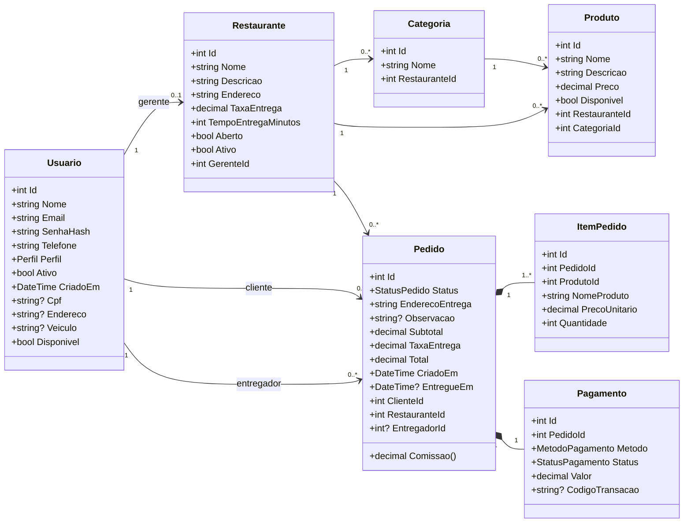
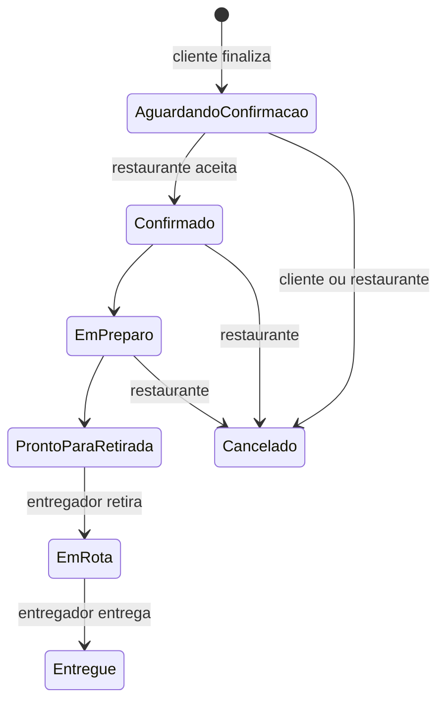

# Modelo de dados

Classes em `DeliveryMarketplace/Models`. Cada classe vira uma tabela no `delivery.db`.

## Enums

| Enum | Valores |
|---|---|
| `Perfil` | Cliente, Restaurante, Entregador, Administrador |
| `StatusPedido` | AguardandoConfirmacao, Confirmado, EmPreparo, ProntoParaRetirada, EmRota, Entregue, Cancelado |
| `MetodoPagamento` | Pix, CartaoCredito, CartaoDebito, Dinheiro |
| `StatusPagamento` | Pendente, Aprovado, Recusado, Estornado |

## Ciclo de vida do pedido

## Decisões de modelagem

1. **Um único `Usuario` com o campo `Perfil`**, em vez de uma classe por tipo de usuário. Campos específicos (CPF, endereço, veículo) são opcionais.
2. **Endereço em texto simples**, para manter o modelo enxuto.
3. **Cópia no pedido**: `ItemPedido` guarda nome e preço, e `Pedido` guarda endereço e taxa no momento da compra.
4. **Enums gravados como texto** no banco, para ficarem legíveis ao abrir o `delivery.db`.
